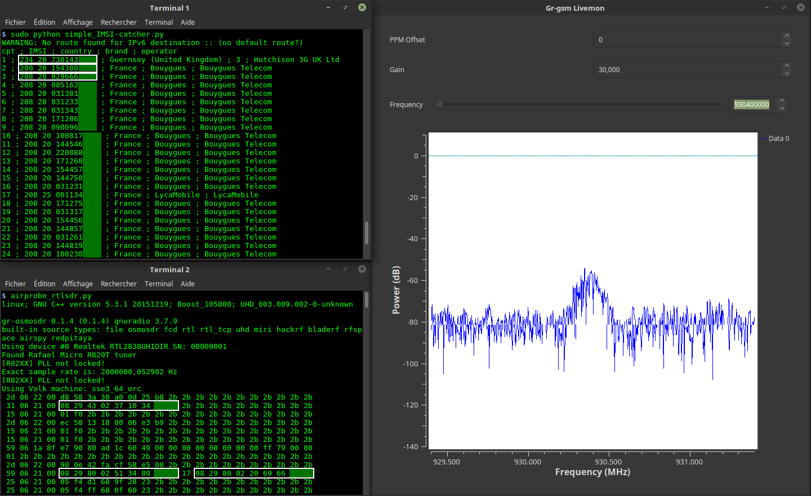

# IMSI-catcher

> Un outil **pédagogique et passif** qui affiche les numéros **IMSI**, le pays, la marque
> et l'opérateur des téléphones mobiles aux alentours, à partir des canaux de diffusion
> **non chiffrés** du réseau GSM (2G).
>
> A **passive, educational** tool that displays the **IMSI** numbers, country, brand and
> operator of nearby mobile phones by listening to the **unencrypted** broadcast channels
> of the GSM (2G) network.



---

## ⚠️ Avertissement légal et éthique / Legal & ethical notice

**🇫🇷 Français**

Ce projet est fourni **uniquement à des fins éducatives et de recherche**, pour comprendre
le fonctionnement des réseaux GSM et leurs faiblesses historiques. Il est **passif** : il
se contente d'**écouter** des trames radio diffusées en clair, sans jamais émettre, brouiller
ou se faire passer pour une antenne-relais.

- **Intercepter des communications d'autrui sans autorisation est illégal** dans la plupart
  des pays (en France : art. 226-15 et 226-3 du Code pénal, et le Code des postes et des
  communications électroniques).
- N'utilisez cet outil que sur **vos propres appareils**, dans un **environnement maîtrisé**
  (cage de Faraday, cellule GSM de test), ou avec une **autorisation écrite explicite**.
- Les auteurs et contributeurs déclinent toute responsabilité en cas d'usage abusif.

**🇬🇧 English**

This project is provided **for educational and research purposes only**, to understand how
GSM networks work and their historical weaknesses. It is **passive**: it only **listens** to
radio frames broadcast in clear text. It never transmits, jams, or impersonates a base station.

- **Intercepting other people's communications without authorization is illegal** in most
  countries.
- Only use this tool on **your own devices**, in a **controlled environment** (Faraday cage,
  test GSM cell), or with **explicit written authorization**.
- The authors and contributors accept no liability for misuse.

---

## 📡 Comment ça marche / How it works

En 2G (GSM), certaines trames de signalisation (BCCH, canaux de *paging*) sont diffusées
**sans chiffrement**. Lorsqu'un téléphone se manifeste sur le réseau, l'antenne peut
l'appeler par son **IMSI** (identifiant permanent de l'abonné) ou par un **TMSI** (identifiant
temporaire). Cet outil décode ces trames et en extrait les identifiants, puis associe le
MCC/MNC au pays et à l'opérateur à l'aide de `mcc-mnc/mcc_codes.json`.

```
  Antenne GSM  ──radio──►  SDR (RTL-SDR / HackRF…)  ──►  grgsm_livemon  ──GSMTAP/UDP──►  simple_IMSI-catcher.py
   (2G/GSM)                   réception RF              décodage GSM         port 4729        extraction IMSI
```

---

## 🧰 Matériel et prérequis / What you need

**Un PC sous GNU/Linux.** Testé avec :
- Debian 10
- Ubuntu 20.04 / LinuxMint 22.2+
- Kali 2025+

**Un récepteur SDR.** Testé avec :
- [Clé USB DVB-T (RTL2832U)](https://osmocom.org/projects/sdr/wiki/rtl-sdr) avec antenne (moins de 15 $)
- [Téléphone OsmocomBB](https://osmocom.org/projects/baseband/wiki/Phones)
- [HackRF](https://greatscottgadgets.com/hackrf/)
- [BladeRF](https://www.nuand.com/bladerf-2-0-micro/)

> ⚠️ N'utilisez **pas** Python 3.9 (bug `ctypes`).

---

## ⚙️ Installation

```bash
git clone https://github.com/Oros42/IMSI-catcher.git
cd IMSI-catcher
```

Dépendances système (SDR + décodeur GSM) :

```bash
sudo apt install python3-numpy python3-scipy python3-scapy gr-gsm
```

Dépendances Python (optionnelles, voir `requirements.txt`) :

```bash
pip install -r requirements.txt
```

### Importlib vs Imp

Depuis Python 3.1, `imp` est remplacé par `importlib` (et `imp` est supprimé à partir de 3.12).

```bash
sudo apt install python3-pip
pip install importlib
```

### Installation de gr-gsm via Docker (non recommandé)

```bash
sudo xhost +local:docker
docker pull atomicpowerman/imsi-catcher
docker run -ti --net=host -e DISPLAY=$DISPLAY --privileged -v /dev/bus/usb:/dev/bus/usb atomicpowerman/imsi-catcher bash
```

Lancez ensuite tous les `grgsm_*` dans ce conteneur.

---

## 🚀 Utilisation / Usage

On utilise `grgsm_livemon` pour décoder le signal GSM et `simple_IMSI-catcher.py` pour
retrouver les IMSI.

```bash
python3 simple_IMSI-catcher.py -h
```

```
Usage: simple_IMSI-catcher.py: [options]

Options:
  -h, --help            show this help message and exit
  -a, --alltmsi         Show TMSI who haven't got IMSI (default : false)
  -i IFACE, --iface=IFACE
                        Interface (default : lo)
  -m IMSI, --imsi=IMSI  IMSI to track (default : None, Example:
                        123456789101112 or "123 45 6789101112")
  -p PORT, --port=PORT  Port (default : 4729)
  -s, --sniff           sniff on interface instead of listening on port
                        (require root/suid access)
  -w SQLITE, --sqlite=SQLITE
                        Save observed IMSI values to specified SQLite file
  -t TXT, --txt=TXT     Save observed IMSI values to specified TXT file
  -z, --mysql           Save observed IMSI values to specified MYSQL DB
```

Ouvrez **2 terminaux**.

Terminal 1 :

```bash
sudo python3 simple_IMSI-catcher.py -s
```

Terminal 2 :

```bash
grgsm_livemon
```

Ajustez la fréquence jusqu'à voir défiler, dans le terminal, quelque chose comme :

```
15 06 21 00 01 f0 2b 2b 2b 2b 2b 2b 2b 2b 2b 2b 2b 2b 2b 2b 2b 2b 2b
25 06 21 00 05 f4 f8 68 03 26 23 2b 2b 2b 2b 2b 2b 2b 2b 2b 2b 2b 2b
49 06 1b 95 cc 02 f8 02 01 9c c8 03 1e 57 a5 01 79 00 00 1c 13 2b 2b
```

### Trouver les fréquences / Find frequencies

```bash
grgsm_scanner
```

```
ARFCN:  974, Freq:  925.0M, CID:     2, LAC:   1337, MCC: 208, MNC:  20, Pwr: -41
ARFCN:  976, Freq:  925.4M, CID:  4242, LAC:   1007, MCC: 208, MNC:  20, Pwr: -45
```

Réglez ensuite la fréquence pour `grgsm_livemon` :

```bash
grgsm_livemon -f 925.4M
```

Pour un HackRF, vous pouvez utiliser `kalibrate-hackrf` :

```bash
sudo apt-get install automake autoconf libhackrf-dev
git clone https://github.com/scateu/kalibrate-hackrf
cd kalibrate-hackrf/ && ./bootstrap && ./configure && make && sudo make install
kal -s GSM900
```

### Wireshark

Vous pouvez observer les paquets GSM avec Wireshark :

```bash
sudo apt install wireshark
sudo wireshark -k -Y '!icmp && gsmtap' -i lo
```

### Journaliser dans une base de données / Log to a database

**SQLite :**

```bash
sudo python3 simple_IMSI-catcher.py -s -w observations.sqlite
```

**Fichier texte :**

```bash
sudo python3 simple_IMSI-catcher.py -s -t observations.txt
```

**MySQL** — utilisez `db-example.sql` pour créer la base, puis :

```bash
cp .env.dist .env
nano .env          # renseignez votre configuration
sudo apt install python3-decouple python3-mysqldb
sudo python3 simple_IMSI-catcher.py -s --mysql
```

### scan-and-livemon (obsolète / no longer used)

```bash
# Terminal 1
python3 scan-and-livemon
# Terminal 2
python3 simple_IMSI-catcher.py
```

---

## 🖼️ Interfaces graphiques / Graphical interfaces

Une galerie illustrée des différentes interfaces (sortie terminal de
`simple_IMSI-catcher.py`, interface graphique `grgsm_livemon`, scanner `grgsm_scanner`
et capture Wireshark) est disponible dans **[`docs/interfaces/`](docs/interfaces/)**.

| Interface | Description |
|-----------|-------------|
| `simple_IMSI-catcher.py` | Tableau terminal : `Nb IMSI ; TMSI ; IMSI ; pays ; marque ; opérateur ; MCC ; MNC ; LAC ; CellId ; Timestamp` |
| `grgsm_livemon` | Interface GNU Radio : spectre de puissance en temps réel + réglages (fréquence, gain, PPM) |
| `grgsm_scanner` | Liste des stations de base GSM détectées (ARFCN, fréquence, CID, LAC, MCC/MNC, puissance) |
| Wireshark | Analyse des trames GSMTAP décodées (paging, system information, mobile identity) |

Ouvrez **[`docs/interfaces/index.html`](docs/interfaces/index.html)** dans un navigateur pour
la galerie complète.

---

## 📁 Structure du dépôt / Repository layout

```
.
├── simple_IMSI-catcher.py          # Programme principal : extraction des IMSI
├── immediate_assignment_catcher.py # Affiche SDCCH / Subchannel / Timeslot / ARFCN
├── scan-and-livemon                # (obsolète) scan + livemon automatique
├── mcc-mnc/
│   ├── mcc_codes.json              # Base MCC/MNC → pays / opérateur
│   └── update_codes.py             # Met à jour mcc_codes.json depuis Wikipédia
├── db-example.sql                  # Schéma MySQL d'exemple
├── Dockerfile                      # Image avec gr-gsm + Wireshark
├── .env.dist                       # Modèle de configuration MySQL
├── requirements.txt                # Dépendances Python
├── capture_simple_IMSI-catcher.png # Capture d'écran réelle
└── docs/interfaces/                # Galerie illustrée des interfaces
```

---

## 🔗 Liens / Links

- Installation de gr-gsm : <https://osmocom.org/projects/gr-gsm/wiki/Installation> et <https://github.com/velichkov/gr-gsm>
- Fréquences : <http://www.worldtimezone.com/gsm.html> et <https://fr.wikipedia.org/wiki/Global_System_for_Mobile_Communications>
- Mobile Network Code : <https://en.wikipedia.org/wiki/Mobile_Network_Code>
- Scapy : <https://scapy.readthedocs.io/>
- IMSI : <https://fr.wikipedia.org/wiki/IMSI>
- Realtek RTL2832U : <https://osmocom.org/projects/sdr/wiki/rtl-sdr>

---

## 📜 Licence / License & crédits

Code principal publié sous **CC0 1.0 Universal** (domaine public) — voir [`LICENSE`](LICENSE).
Le script `scan-and-livemon` est sous GPL v2 (au choix).

Projet original : **[Oros42/IMSI-catcher](https://github.com/Oros42/IMSI-catcher)** par *Oros*
et ses contributeurs. Ce dépôt en est une copie enrichie (documentation, structure, galerie
d'interfaces).

## ✉️ Contact

hisseinbanaye39@gmail.com
